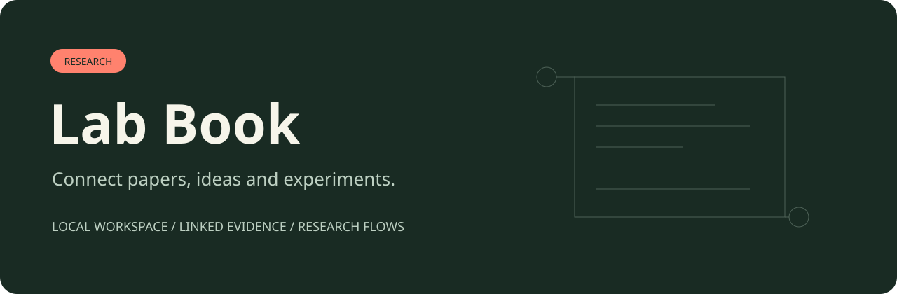
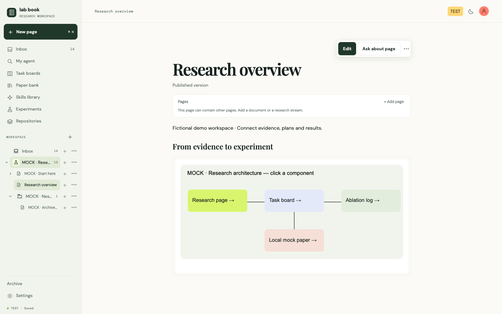
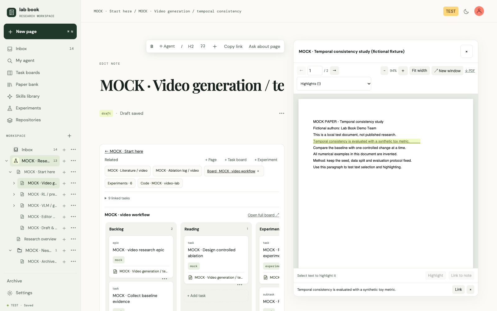
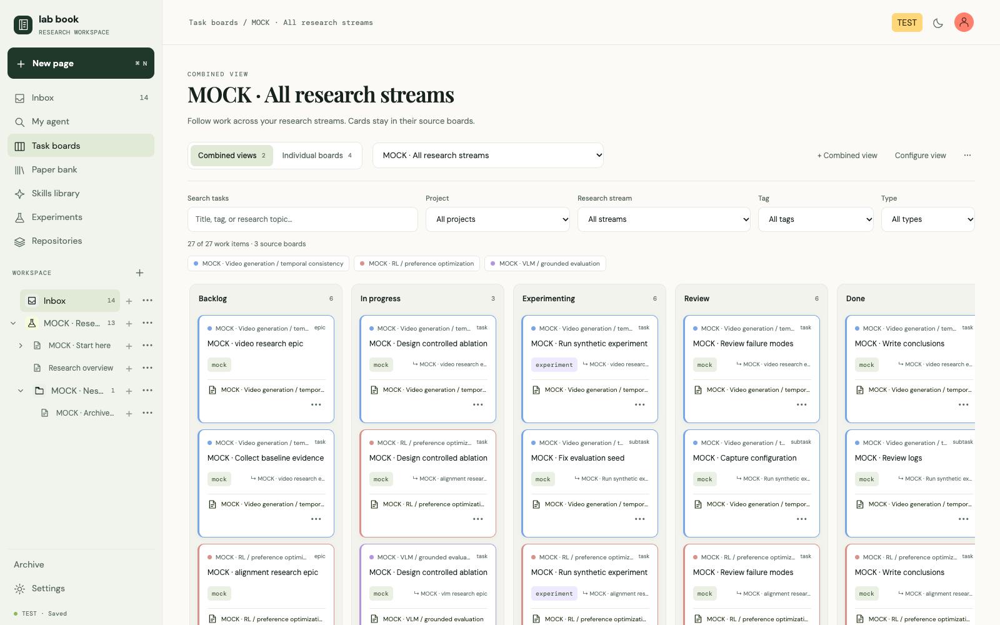
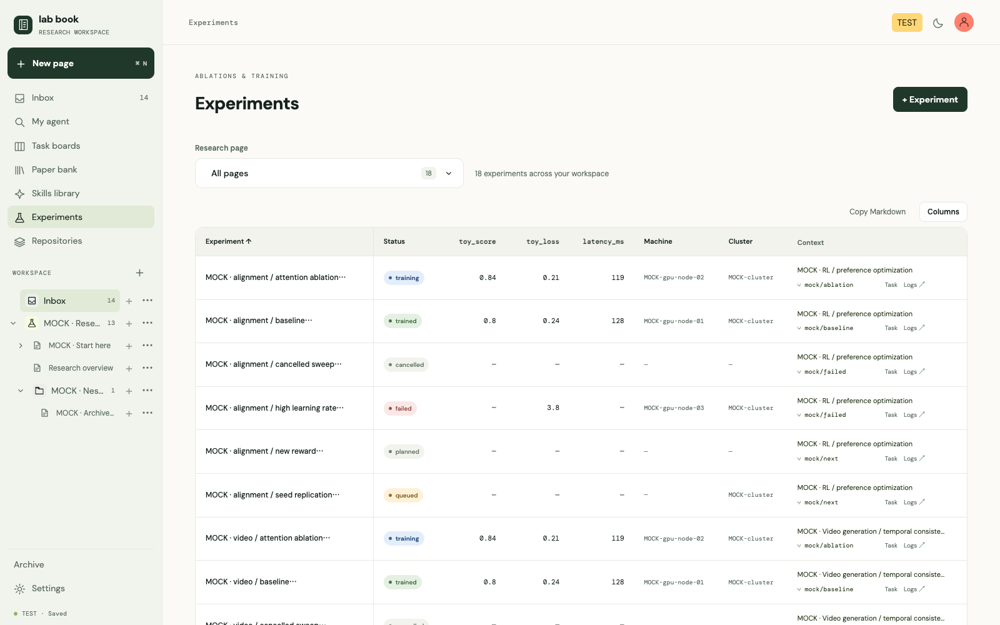
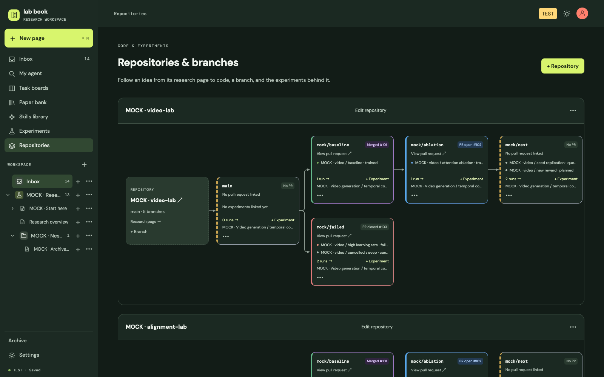
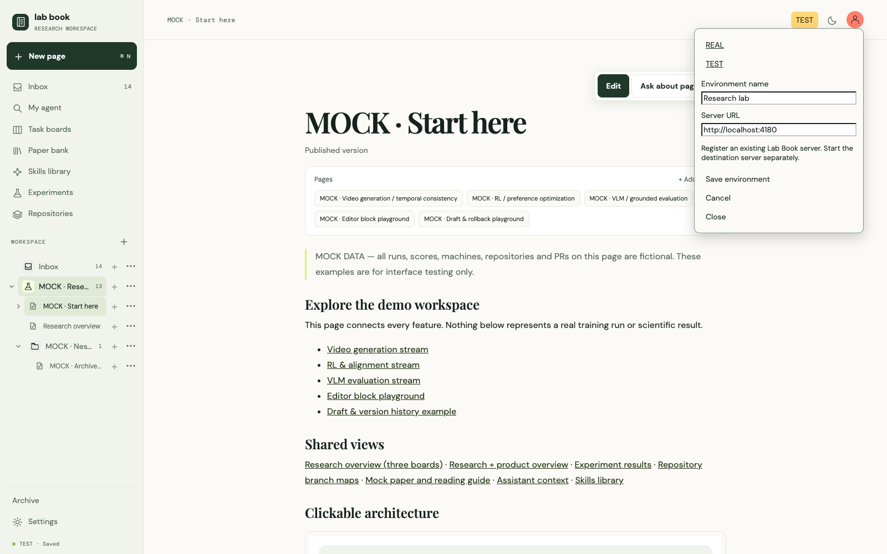

# Lab Book

> You could absolutely build this with AI. I got there first so you don’t have to spend your tokens building it again.

<p align="center">
  <a href="src/client"></a>
  <a href="package.json"></a>
  <a href="src/electron"></a>
  <a href="#get-started"></a>
</p>
<p align="center">
  <a href="https://github.com/adriaciurana/lab-book/actions/workflows/test.yml"></a>
  <a href="#development-and-verification"></a>
  <a href="#configuration-and-access"></a>
  <a href="LICENSE"></a>
</p>

A local research workspace that connects papers, annotated PDFs, nested notes, task boards and experiments. Use it in your browser or as an Electron desktop app. Your workspace stays in local files; optional AI features send selected context to OpenAI.

## See the workflow

These are screenshots of the real app using fictional demo data. Scores, machines and repository branches are fictional. The PDF annotation screenshot uses a published paper.



*Start with a research page. Connect the question, supporting papers, experiment plans and related work through navigable pages and diagrams.*

<table>
<tr>
<td width="50%">

### Read evidence beside your notes

[](docs/images/screenshots/paper-annotations.png)

Open a paper beside your draft, highlight a passage and link it back to a note. Shown here: [Auto-Encoding Variational Bayes](https://arxiv.org/abs/1312.6114v11) by Diederik P. Kingma and Max Welling.

</td>
<td width="50%">

### Turn a plan into tasks

[](docs/images/screenshots/task-boards.png)

Track epics, tasks and subtasks. Combined views bring several boards together without duplicating their tasks.

</td>
</tr>
<tr>
<td width="50%">

### Compare experiments

[](docs/images/screenshots/experiment-results.png)

Compare baselines and ablations, inspect run states and keep metrics connected to their research page and code branch.

</td>
<td width="50%">

### Keep code in context

[](docs/images/screenshots/repository-branches.png)

Record branch relationships, pull request states and linked runs. Repository records describe your work; they do not execute Git operations.

</td>
</tr>
</table>

<details>
<summary><strong>Switch between registered environments</strong></summary>



Click **REAL** or **TEST**, then choose a destination or **Create environment** to register another server by name and URL.

</details>

Click any gallery image to inspect it at full resolution. To regenerate the screenshots with a temporary demo workspace, run `npm run screenshots`. No personal workspace data or paid AI requests are used. See [the capture guide](docs/screenshots.md).

## Get started

Requires **Node.js 22+**, npm and macOS or Linux for the shell launchers. Windows users can use the npm commands directly.

```sh
git clone https://github.com/adriaciurana/lab-book.git
cd lab-book
./install.sh
./run_server.sh
```

Open **http://localhost:4173**. No API key is required for notes, papers, boards or experiment records. Set `OPENAI_API_KEY` in the process environment to use the assistant and literature discovery. Requests can incur API charges.

```sh
./run_electron.sh          # desktop app, built-in server on port 4174
./run_server.sh --test    # separate TEST workspace on port 4175
./run_server.sh --mdns    # advertise an HTTP service on your local network
```

`--mdns` requires `dns-sd` on macOS or `avahi-publish-service` from avahi-utils on Linux. It binds to all interfaces by default. Discover the advertised service using your network's DNS-SD browser; the script does not reserve a custom hostname. Override `HOST` and `PORT` as needed. Localhost is the default without mDNS.

## Your research, connected

- Import papers, read local PDFs, annotate passages and link evidence into notes.
- Write nested research pages with equations, diagrams and versioned drafts.
- Organize boards, tasks, repositories, runs and typed ablation tables.
- Ask the assistant about selected research context and review proposed workspace changes before applying them.
- Expose structured research records through the [agent API](agent-api.md).

See the [full user guide](docs/user-guide.md) for editing, paper management and research workflows.

To open the English research showcase, start `./run_server.sh --test`, run
`npm run seed:test` in another terminal, and open
[Research Lab Demo](http://localhost:4175/notes/showcase-start).
The demo includes diffusion, VAE and LLM studies with fictional metrics, branches
and linked tasks. Re-running the seed preserves existing records.

## Switch environments

The installer creates `labbook.config.json` from [the example](labbook.config.example.json). Click **REAL** or **TEST** in the top bar, then **Create environment** to register a name and HTTP(S) server URL. You can also edit the configuration file directly. Saved environments appear immediately in the menu. The destination server must already be running. Navigation opens the destination home page; it never copies workspace data. For a desktop destination, register `http://localhost:4174`.

Production and TEST use separate directories under `data/production` and `data/test`. Set `LABBOOK_DATA_DIR` to move the data root. Packaged desktop builds use Electron's user data directory. Back up the entire data root, including attachments and PDFs. Data and local configuration are excluded from Git.

## Scheduled SOTA reviews

The server and desktop app include a lightweight scheduler. In **Settings → SOTA review**, enable reviews, choose an interval (1–365 days) and a model. Automatic reviews are disabled until explicitly enabled. Keep the server running, or minimize the desktop window, for periodic checks. Closing the process stops checks; missed reviews resume on the next start. No OS service installation is needed.

The scheduler checks once a minute, prevents overlapping scheduled runs in that process, retries failed attempts after an hour and records the interval from the last successful review. Run one server per environment. Reviews discover candidates through OpenAI search, retrieve paper metadata and skip existing papers. They add papers to the bank; they do not launch training or independently certify SOTA claims. Reports and configuration are saved under the active environment's data directory.

For an always-on server, supervise `node src/server/server.cjs` using your OS service manager with the same data directory and environment variables. Historical `sota-install` scripts are deprecated: remove any old `com.labbook.sota-review` LaunchAgent before relying on the built-in scheduler.

## Configuration and access

| Variable | Purpose |
| --- | --- |
| `PORT`, `HOST` | Browser server address (defaults: 4173, 127.0.0.1) |
| `LABBOOK_DATA_DIR` | Persistent data root |
| `LABBOOK_CONFIG` | Path to environment registry JSON |
| `OPENAI_API_KEY` | Optional server-side AI credentials |
| `LABBOOK_AGENT_TOKEN` | Bearer token for the structured agent API |
| `LABBOOK_SOTA_MODEL` | Override literature review model |

This is a trusted local workspace, not a multi-tenant hosted application. The agent token protects the agent API; it does not authenticate every UI endpoint. Use a VPN or an authenticated reverse proxy before exposing it beyond trusted devices. Do not commit API keys, research data or downloaded papers. Some legacy AI helpers also read exported keys from shell profile files.

## Development and verification

```sh
npm ci
npm test
npm run test:coverage
npm run desktop
npm run package:desktop
```

The default test suite covers isolated server persistence, the research API, typed columns, lifecycle behavior, environment configuration and SOTA scheduling. Coverage uses Node's built-in instrumentation and prints measured results; it is not a claim of full UI coverage. Additional `test:*` scripts exercise Electron browser flows and generally require a running local server. Tests use simulated AI responses and temporary storage.

CI runs the default suite with coverage on Linux. See [CONTRIBUTING.md](CONTRIBUTING.md) for contribution checks and [SECURITY.md](SECURITY.md) for reporting issues. Lab Book is licensed under the [MIT License](LICENSE).

## Project structure

```text
src/
  client/       Browser UI, styles, HTML and vendored browser assets
  server/       HTTP server, persistence, research API and AI services
  shared/       Models and validation reused by browser and server
  electron/     Desktop application entry point
  paths.cjs     Stable project root for data and configuration
scripts/        Seeding, migration, maintenance and SOTA scheduling
tests/         Node and Electron regression tests
docs/          User guide and project artwork
deploy/        Service and reverse proxy examples
```

Browser asset URLs stay stable. The server exposes client assets and shared modules without exposing server source. Workspace data remains under the existing `data/` directory; this reorganization does not require a migration. Launch from the project root with the shell launchers or npm scripts.

### Administrator and member accounts

Run `./install.sh --setup-admin` to create an administrator for a new managed workspace. Choose a temporary password of at least 12 characters. The first sign-in requires setting a different password. Serve managed workspaces over HTTPS for network access and set `LABBOOK_HTTPS=1` when TLS is terminated by a trusted proxy.

After changing the temporary password, the first administrator sees **Account settings** and must choose a shared team key or personal credentials before anyone can use **My agent**. Use the same settings to add members and change their roles. A member who uses personal credentials gets a setup reminder until a key is configured. The workspace policy supports OpenAI and Claude API keys. Claude chat currently supports text responses without web search, attachments or structured workspace proposals. Claude uses a [Claude Console API key](https://platform.claude.com/docs/en/manage-claude/authentication) in both credential modes. Anthropic reserves Claude subscription sign-in for its own apps and supported flows. See [Anthropic’s authentication guidance](https://code.claude.com/docs/en/legal-and-compliance).

Open a page and choose **Share** to set its visibility to private, workspace-wide read access or selected members. Give specific members **Can view** or **Can edit**. The administrator can manage all pages. Member workspace views currently cover notes and personal chat history. Boards, experiment registries, PDFs and administration remain restricted to the administrator. Member-authored notes support basic rich text, and unsupported markup is stripped on save.

In a managed workspace with personal AI credentials enabled, **Continue with ChatGPT** is available when browsing Lab Book at `http://127.0.0.1:<port>`. For a server on another machine, use a trusted SSH tunnel with the same local and remote port, then sign in through the forwarded address. The ChatGPT permission is tied to the active Lab Book account. Lab Book stores its OAuth credentials in the server's protected account registry and uses the plan only for eligible chat requests. You can revoke access in [ChatGPT Settings](https://chatgpt.com/#settings). The shared key remains available when the administrator selects team mode.
